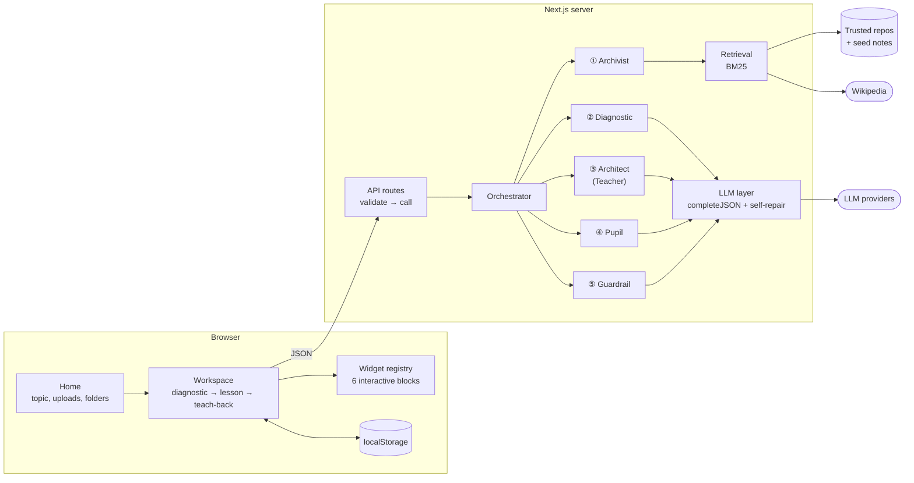

<div align="center">


# Feynman Lab

### Learn it by doing. Prove it by teaching.

**Learn technical concepts through interactive AI lessons, then test your understanding by teaching an AI pupil.**


</div>

---

## Problem statement

Learning a technical topic today usually means one of three things, and each has a gap.

1. **Passive content feels like learning but often isn't.** Watching a video or reading docs gives an *illusion of competence*. You recognise the ideas, but you can't use them or explain them. Concepts like a TCP handshake, B-tree splits or React reconciliation are dynamic systems, and static text is a poor way to show them.
2. **AI chat tutors are fluent but unreliable.** A general chatbot answers in plain prose, invents details with confidence, and rarely shows where a claim came from. It also grades generously, so it can't tell you whether you actually understand.
3. **Courses are one-size-fits-all.** A fixed syllabus can't tell that you already know the basics but hold one specific misconception. You either sit through what you know or skip something you didn't.

The **Feynman technique** offers a practical way to expose gaps: explain an idea in plain words to someone who keeps asking "why?". The catch is that it needs a patient listener who knows which points matter, and most learners don't have one.

## Solution

Feynman Lab turns learning into a two-phase loop run by five cooperating AI agents.

| Phase | What happens |
|---|---|
| **1 · Diagnose** | Answer 3–4 calibration questions, from mental model to implementation. The system scores your level and names your misconceptions. |
| **2 · Learn by doing** | A **Teacher** agent builds an interactive lesson for *your* level, chosen length, depth and amount of interactivity. Blocks go through structural and citation checks, with a source-fidelity audit when sources and time allow. |
| **3 · Reshape it** | Don't like a section? Click **✦**, describe what you imagined, and only that block is rewritten and re-checked. **↶ Undo** is one click away. |
| **4 · Prove it by teaching** | Explain the topic to a **Pupil** agent at Easy, Medium or Difficult. It asks one probing question at a time and, on Difficult, plants plausible misconceptions to see if you catch them. |
| **5 · Get your scorecard** | A hidden rubric fills in live. Gaps link straight back to the widget that teaches them, and anything that feels unfair can be disputed. |
| **6 · Keep your notes** | Capture any widget or diagram state into a topic folder and export it as a Markdown study sheet. |

What makes it different from asking a chatbot:

- **The model never writes UI code.** It emits typed JSON props for a fixed set of React components (Server-Driven UI), so generated lessons are safe and consistent.
- **Citations resolve to retrieved sources.** The model supplies chunk IDs; the server resolves known IDs to source URLs and drops unknown references. A citation alone does not guarantee a claim is correct.
- **Grading is checked against your explanation.** The Pupil proposes rubric updates, and the Guardrail checks the evidence against the learner's words. Learners can dispute the result.

---

## Architecture

Feynman Lab is a single Next.js app. Thin API routes validate requests and hand them to one **orchestrator**, which sequences five agents that share strict zod contracts.



### The five agents

| # | Agent | Role | File |
|---|---|---|---|
| ① | **Coursework & Repo Archivist** | Retrieves grounded source chunks (BM25 over repos, seed notes, uploads and Wikipedia), writes the hidden rubric, extracts notes. | `lib/agents/archivist.ts` |
| ② | **Diagnostic Assessor** | Writes calibration questions, scores them deterministically (deeper questions weigh more), and names misconceptions → `LearnerProfile`. | `lib/agents/diagnostic.ts` |
| ③ | **Sandbox Architect** (Teacher) | Generates the lesson as JSON props for the widget registry; rewrites one block or the whole lesson on request. Never emits HTML or JS. | `lib/agents/architect.ts` |
| ④ | **Socratic Protégé** (Pupil) | A naive classmate persona. One question per turn, scaled by difficulty, graded against the hidden rubric. | `lib/agents/pupil.ts` |
| ⑤ | **Compliance Manager** (Guardrail) | Structural repair, citation resolution, fidelity audit with one regeneration, Pupil audit, dispute resolution. | `lib/agents/guardrail.ts` |

### How a request flows

```
topic   ─▶ ① Archivist ── source chunks ──▶ ② Diagnostic ── 3–4 questions
answers ─▶ ② Diagnostic ── LearnerProfile ──▶ ③ Architect ── LessonDraft (typed JSON)
        ─▶ ⑤ Guardrail ── checked, cited blocks ──▶ ① Archivist ── hidden rubric
explain ─▶ ④ Pupil ── question + rubric updates ──▶ ⑤ Guardrail ── audited updates
flag    ─▶ ⑤ Guardrail ── verdict ──▶ regenerated block / rubric patch / re-grade
```

A typical lesson request with a real provider uses four model calls: learner profile, lesson generation, source-fidelity audit and rubric creation. Regeneration and JSON repair can add calls; the earlier diagnostic is a separate request. Each request has a time budget. Optional audits and regeneration can be skipped and reported when time runs short; required calls can still time out.

### Validation and reliability

- **Schema-first output.** Every model response is parsed with zod. Failures are fed back to the model for self-repair (up to 2 retries), and unknown keys are stripped, so the model can't inject colours, HTML or event handlers.
- **Formulas, not code.** Slider outputs are expressions run by a tiny sandboxed parser (`lib/expr.ts`). Nothing is ever `eval`'d.
- **Structural repair.** Edges to missing nodes, out-of-range answers, trace lines past the end of the code, overlapping nodes: fixed or dropped, and shown on an "auto-repaired" badge.
- **Real citations only.** Blocks with no resolvable source are labelled **unverified**; general knowledge used when sources are thin is labelled **◇ model knowledge**.
- **Fidelity audit.** One pass checks every block's claims against its sources. Unsupported blocks are regenerated once, then flagged.
- **Evidence checks for grading.** Proposed mastery and gap updates are checked against the learner's transcript before they are applied.
- **Learner advocacy.** "⚑ Flag issue" and "Unfair?" open a dispute. Only an upheld dispute changes anything.
- **Render isolation.** Each widget has its own error boundary with "Report & regenerate", so one bad block never breaks the lesson.

> 📖 For contracts, request flows, the safety model and design decisions in depth, see **[ARCHITECTURE.md](ARCHITECTURE.md)**.

These checks reduce errors; generated explanations and grading can still be wrong. The MVP is a learning aid, and its client-visible rubric is not suitable for secure examinations.

## Key features

- **Personalised lessons:** a short diagnostic identifies prior knowledge and misconceptions before generation.
- **Six lesson blocks:** concepts, sliders, sequence diagrams, architecture canvases, code traces and prediction questions.
- **Lesson controls:** choose length, depth and interactivity; use **✦ Reimagine** to rewrite a section or the whole lesson, with undo.
- **Teach-back:** explain the topic to an AI pupil at Easy, Medium or Difficult, then review a scorecard linked to lesson blocks.
- **Learner feedback:** flag a lesson issue or dispute a grade for review.
- **Notes and voice:** capture widget states, organise topic folders, export Markdown notes, listen to narration and dictate explanations where the browser supports speech.
- **Offline demo and provider choice:** try the scripted TCP lesson without a key, or configure a supported model provider for other topics and free-text rewrites.
- **Light and dark themes:** semantic colours distinguish movable controls, valid states and gaps.

---

## Tech stack

| Concern | Choice | Why |
|---|---|---|
| Framework | **Next.js 16** (App Router, Turbopack) + **React 19** | One deployable for pages and API routes |
| Language | **TypeScript** (strict) | Shared types from server to widgets |
| Validation | **zod 4** | Every API request *and* every LLM response |
| Diagrams | **@xyflow/react** (React Flow 12) | Draggable architecture canvas |
| LLM access | Plain `fetch` adapters | No vendor SDKs; a new provider is ~30 lines |
| Retrieval | Hand-written **BM25** + Wikipedia search | In-process, zero extra dependencies |
| Voice | Browser **Web Speech API** | Narration, Pupil voice, hands-free dictation |
| Persistence | `localStorage` / `sessionStorage` | No database or accounts needed for the MVP |
| Styling | One `globals.css`, 5 semantic colours | Light and dark mode from the same tokens |
| Hosting | **Vercel** (Fluid compute) | Long lesson routes up to 300 s |

Runtime dependencies are just `next`, `react`, `react-dom`, `zod` and `@xyflow/react`.

### Interactive widget registry (Server-Driven UI)

The Teacher can only build lessons from these six components (`components/blocks/registry.tsx`):

| Block type | Component | The learner can… |
|---|---|---|
| `concept` | `ConceptBlock` | read and hear narration |
| `slider` | `InteractiveSliderBlock` | drag parameters, watch outputs turn green/red, see a sweep chart |
| `stepper` | `FlowStepperDiagram` | play/step a sequence diagram, switch failure scenarios, inspect state |
| `architecture` | `DraggableArchitectureCanvas` | drag nodes, open deep dives, draw missing edges in a challenge |
| `code` | `ConceptCodeTracer` | step through code with live variables |
| `predict` | `PredictionBlock` | commit to a prediction before the reveal |

---

## Quick start

Requires **Node.js 20.9+** and npm. Run these commands from the project directory.

```bash
npm install
```

Copy the example configuration (PowerShell):

```powershell
Copy-Item .env.example .env.local
```

On macOS or Linux, use `cp .env.example .env.local`. Keep `LLM_PROVIDER=mock` for the demo, then start the app:

```bash
npm run dev
```

Open [localhost:3000](http://localhost:3000) and pick **TCP 3-Way Handshake**. After dependencies are installed, the scripted learning loop works without a model API or network access:
diagnostic → personalised lesson → notes → teach-back → scorecard → disputes.

Mock mode uses fixtures and keyword-based grading. Generating other topics or rewriting sections from free-text instructions requires a real provider.

### Use a real model (any topic)

Set one provider in `.env.local`, add its credentials, and restart the development server:

| `LLM_PROVIDER` | Needs | Bundled default (`LLM_MODEL` overrides) |
|---|---|---|
| `anthropic` | `ANTHROPIC_API_KEY` | `claude-sonnet-5-5` |
| `openai` | `OPENAI_API_KEY` | `gpt-4.1-mini` |
| `gemini` | `GEMINI_API_KEY` | `gemini-2.5-flash` |
| `openai-compatible` | `OPENAI_COMPATIBLE_BASE_URL` (+ key if needed) | `llama3.1` (Ollama, Groq, Together, vLLM, LM Studio…) |
| `mock` | nothing | scripted TCP lesson |

These defaults reflect the repository configuration, not a guarantee of provider availability. Set `LLM_MODEL` to a model available to your account or local server. See [`lib/llm/index.ts`](lib/llm/index.ts) for adapter behaviour.

For example:

```dotenv
LLM_PROVIDER=openai
OPENAI_API_KEY=your-api-key
LLM_MODEL=gpt-4.1-mini
```

Keep credentials in `.env.local` or your host's environment settings.

### Configuration reference

| Variable | Purpose |
|---|---|
| `LLM_PROVIDER` | `mock` (default) · `anthropic` · `openai` · `gemini` · `openai-compatible` |
| `LLM_MODEL` | Override the provider's default model |
| `ANTHROPIC_API_KEY` · `OPENAI_API_KEY` · `GEMINI_API_KEY` | Provider credentials (server-side only) |
| `OPENAI_COMPATIBLE_BASE_URL` · `OPENAI_COMPATIBLE_API_KEY` | Self-hosted or third-party OpenAI-compatible servers |
| `WEB_SEARCH` | `on` (default) / `off` — Wikipedia grounding; always off in mock mode |
| `WEB_SEARCH_LANG` | Wikipedia edition (default `en`) |
| `LLM_TIMEOUT_MS` | Fixed per-call timeout (default scales 60–240 s with output size) |
| `GITHUB_TOKEN` | Higher GitHub limits for `npm run ingest` when listing folders |

### Scripts

| Command | What it does |
|---|---|
| `npm run dev` | Start the dev server |
| `npm run build` / `npm start` | Production build and serve |
| `npm run build:vercel` | Ingest trusted repos, then build (used on Vercel) |
| `npm run ingest` | Pull Markdown from `config/trusted-repos.json` into `data/corpus.json` |
| `npm run typecheck` | `tsc --noEmit` |

---

## Grounding: where lessons come from

| Source | How it gets in |
|---|---|
| **Trusted GitHub repos** | `npm run ingest` pulls the Markdown listed in `config/trusted-repos.json` (restart the server afterwards). `npm run ingest -- docker` refreshes only matching repos. |
| **Seed notes** | Curated files in `content/seed/` (the TCP note cites IETF RFCs). |
| **Wikipedia** | With a real provider, every topic is searched and cited per section with deep links. No key needed. |
| **Your syllabus** | Upload up to 10 `.md` / `.txt` files (200k characters each) on the home page. They're ranked alongside the repos for that browser session. |

The default repo list covers the suggested topics: system-design-primer, react-fiber-architecture, react.dev, Docker networking docs, cstack/db_tutorial (B-trees), RAG_Techniques and MDN's TCP pages. Ingest never fails the process: a repo that can't be fetched keeps its previously ingested files.

---

## Demo script

Allow about three minutes for the offline walkthrough.

1. Home → **TCP 3-Way Handshake**. Answer the 4 diagnostic questions (get one wrong on purpose).
2. Lesson: step through the handshake, switch to **SYN-ACK lost** (red), drag the RTT/loss sliders, solve the state-machine challenge, step the SYN-cookie trace. Hit **＋ Capture** on a few things.
3. **Teach the Pupil** → Medium. Explain the handshake, then claim "two messages would be enough" and watch it go red. Finish → scorecard → **Review block →** jumps back to the exact widget.
4. Click **Unfair?** on a red item or **⚑ Flag issue** on a block to show the guardrail agent.
5. Notes → **Export .md**.

---

## Deploy on Vercel

| Setting | Value |
|---|---|
| Framework Preset | **Next.js** |
| Build Command | `npm run build:vercel` (ingests the trusted repos, then `next build`) |
| Output Directory | leave empty (the preset handles `.next`) |
| Install Command | `npm install` (default; `npm ci` also works) |
| Node.js Version | A host-supported version satisfying `node >=20.9.0` |

- **Why `build:vercel`:** `data/corpus.json` is gitignored, so a plain `next build` ships only the seed notes and Wikipedia. `next.config.mjs` traces `data/**` and `content/**` into the API functions.
- **Environment variables:** `LLM_PROVIDER` plus the matching key, and optionally the other variables from the [configuration reference](#configuration-reference). Without `LLM_PROVIDER` the deployment runs the offline demo.
- **Function duration:** `/api/lesson` and `/api/reimagine` declare `maxDuration = 300`. Check that your hosting plan and function settings support that duration; shorter host limits can interrupt long lessons.
- **Disputes:** the filesystem is read-only, so dispute decisions go to the function logs instead of `data/disputes.jsonl`.

---

## Project structure

```
app/                        pages (home, /study) + API routes
  api/                      diagnostic · lesson · reimagine · pupil · scorecard · notes · dispute · status
components/
  blocks/                   widget registry + the 6 interactive widgets
  workspace/                split-screen workspace, diagnostic, notes drawer, Pupil panel, ✦ dialog
lib/
  orchestrator.ts           sequences the agents; the only module routes call
  agents/                   the 5 agents
  llm/                      provider-agnostic adapters + validated JSON with self-repair
  retrieval/                heading-anchored chunking, BM25, corpus loading, Wikipedia search
  schemas/                  zod contracts for every artifact
  expr.ts                   sandboxed formula engine for sliders
  lesson-options.ts         what Length / Depth / Interactivity mean
  fixtures/tcp.ts           offline demo content (and a reference for good agent output)
  client/                   API wrapper, storage, speech, theme, safe Markdown renderer
content/seed/               curated seed notes
config/trusted-repos.json   allow-list of sources for ingestion
scripts/ingest-github.mjs   repo → data/corpus.json
```

---

## Extending it

| To… | Change |
|---|---|
| Add an LLM provider | `lib/llm/index.ts`: a `callX()` function and a `switch` case |
| Add a widget type | zod schema in the `LessonBlock` union → `REGISTRY_SPEC` in `architect.ts` → `checkBlock()` → component → `registry.tsx` |
| Add trusted sources | Edit `config/trusted-repos.json` → `npm run ingest` → restart |
| Swap BM25 for embeddings | Replace `retrieve()` in `lib/retrieval`; keep the `Chunk` shape so citations still work |
| Add offline topics | Add a fixture next to `lib/fixtures/tcp.ts` and route the mock branches by topic |

---

## Known limits and roadmap

- **Rubric lives on the client.** The "hidden" rubric and statuses are sent to the browser; a server-side session store and server-authoritative grading would be needed for assessment integrity.
- **No auth, rate limits or cost controls** yet. Storage is per-browser; accounts and a database would enable multi-device folders.
- **Uploads are Markdown/text only.** PDF parsing (e.g. `pdfjs-dist`) is a natural next step.
- **Retrieval is lexical (BM25)** and web grounding is Wikipedia only. Embeddings and a general web-search API would help with large corpora and very new tools.
- **Offline mode ships one topic** (TCP); every other topic needs a provider.
- **Lesson latency** on slow models can approach the 300 s limit for Deep-dive lessons. Streaming could show progress earlier, but generation would still need to fit the host's execution limits.
- **No automated tests or CI** beyond `npm run typecheck`.

## Development and contributions

1. Follow [`AGENTS.md`](AGENTS.md), including its requirement to read the relevant bundled Next.js guides before changing application code.
2. Keep API routes thin, put workflow changes in `lib/orchestrator.ts`, and validate new agent outputs with the shared schemas.
3. Run `npm run typecheck` and `npm run build` for application changes. Use the [demo script](#demo-script) to exercise the learning flow, and try a configured provider when changing generation behaviour.
4. Describe the change, how it was verified and any configuration it needs in the pull request.

## Troubleshooting

| Symptom | What to check |
|---|---|
| A new topic produces the TCP lesson | The app is in mock mode. Set a real `LLM_PROVIDER`, add its credentials and restart. |
| A provider rejects the request | Check the matching API key, `LLM_MODEL` and, for compatible servers, `OPENAI_COMPATIBLE_BASE_URL`. |
| A lesson times out | Try a shorter lesson or a faster model, and check the host's function duration. |
| Expected repository sources are missing | Run `npm run ingest`, inspect its output and restart the server. |
| Notes or folders do not persist | Check browser storage availability. Storage belongs to the current browser; export notes to keep a separate copy. |
| Dictation is unavailable | Check browser speech support and microphone permission. Typed teach-back remains available. |

## License

No license file is currently included in this repository.

---

<div align="center">

**Feynman Lab** · hackathon MVP v0.1.0 · *Learn it by doing. Prove it by teaching.*

</div>
